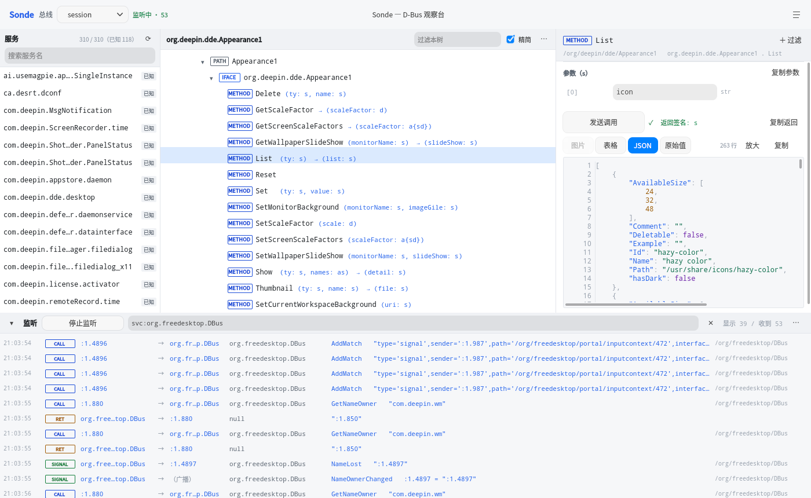

# Sonde

> D-Bus 观察台 —— 像 d-spy 一样浏览，但要顺手得多。

**Sonde**（法语"探针"）是一个 D-Bus 调试工具：左边列服务，中间展开对象树，右边读属性 / 调方法，
底下一栏实时看消息流。界面用 DTK（Deepin Tool Kit）原生控件，浅色为主，跟随系统深浅色。



## 特点

**浏览**

- 服务 → 对象路径 → 接口 → 方法 / 信号 / 属性，逐层展开；点一个服务会自动定位到与它同名的
  对象路径（`org.deepin.dde.Timedate1` → `/org/deepin/dde/Timedate1`）并展开它自己的接口，
  不用在几十个兄弟对象里翻
- 方法签名直接写在括号里并带参数名（`List (ty: s) → (list: s)`），参数一种颜色、返回值另一种，
  不展开也能看清签名
- 单击选中；双击有子节点的展开/收起，双击属性直接读值
- 每栏都有过滤框：左边搜服务名，中间过滤本树（自动展开命中节点）

**调用与读值**

- 点方法 → 右边按签名生成参数表单，填完「发送调用」
- 参数是记录形态（`a{ss}` / `a{sd}` 这类字典，或"字段全是标量"的结构体数组）时自动换成
  **可编辑表格**：表头是列名，每行一个条目，可增删、单元格直接改；嵌套结构继续走行式编辑器
- 属性可读、可定时轮询、可写（走 `Properties.Set`，写完自动回读确认）

**值怎么显示**

返回值里的 JSON 会被自动识别并当作结构化数据（很多接口把 JSON 塞在字符串里返回），
给一组页签，并自动挑一个默认页签；用不上的页签置灰：

| 页签 | 什么时候可用 | 内容 |
|---|---|---|
| 图片 | 值是图片路径或 `file://` URI | 直接预览，显示像素尺寸 |
| 表格 | 数组里全是对象 / 对象里全是标量 | 真正的列，横竖都能滚；单元格是图片路径就给缩略图；可划词选中、右键复制单元格/行/整表 |
| JSON | 内容是合法 JSON | 带行号 + 语法高亮的代码视图，可选中复制 |
| 原始值 | 总是 | 原样的字符串，不做解析 |

「放大」可以把表格 / JSON 开到全屏看。

**看消息**

- 底部面板一条过滤框管所有：`svc:org.deepin.dde.Appearance1 prop:Opacity`，空格分隔多个条件是 AND
- 任意节点右键「加入过滤条件」，条件会追加进过滤框
- 消息点一下看完整解码；行里的 sender / 接收者可以直接点，跳到那个服务的对象树
  （接收者为空显示「（广播）」）

**过滤字段**（值是子串匹配，不带字段名则在整行内容里找）

| 字段 | 含义 |
|---|---|
| `type` | `method_call` / `method_return` / `signal` / `error` |
| `iface` / `member` / `path` / `sig` | 接口 / 成员 / 对象路径 / 签名 |
| `sender` / `dest` / `svc` | 发送者 / 接收者 / 两者之一 |
| `prop` | 属性名（匹配一行摘要，两种信号风格都覆盖） |

## 构建与运行

依赖：Qt 6.8（含 QuickControls2）、Rust 工具链、cmake + ninja。DTK6 可选——找到 `dtk6gui`
就用 DTK 原生样式，没装也能构建（回退 Qt 默认样式）。

```bash
./build.sh          # 1. cargo 编 Rust 解码核心  2. cmake + ninja 编 Qt 前端
./build/sonde
```

QML 从源码目录加载（`SONDE_QML_DIR`），改完即生效，不用重编。

### 命令行

| 参数 | 说明 |
|---|---|
| `--bus session\|system` | 要监听的总线（默认 session） |
| `--service <dest>` | 启动时自动打开的服务 |
| `--dark` / `--light` | 指定主题（默认跟随系统） |
| `--filter <query>` | 启动时设置过滤条件并开始监听 |

自检 / 截图（无显示环境可用，配 `QT_QPA_PLATFORM=offscreen`）：

| 参数 | 说明 |
|---|---|
| `--demo` | 监听 + 打开服务 + 选个方法真跑一次，一条命令走完三条链路 |
| `--demo-method <name>` / `--demo-seed <value>` | 自检时优先选中的方法、给第一个字符串参数填的值 |
| `--force-tab image\|table\|json\|text` / `--expand-json` | 强制输出页签 / JSON 默认展开 |
| `--size <WxH>` / `--screenshot <path>` / `--screenshot-delay <ms>` | 窗口尺寸 / 渲染一帧存 PNG 后退出 / 截图前等待 |
| `--dump-tree` | 打印对象树的行（id/kind/name/depth）后退出 |

### 无界面调用

```bash
# 读属性
./build/sonde --call org.freedesktop.DBus.Properties.Get \
  --call-dest org.deepin.dde.Appearance1 --call-path /org/deepin/dde/Appearance1 \
  --call-sig ss --call-args '["org.deepin.dde.Appearance1","IconTheme"]'

# 调方法
./build/sonde --call org.deepin.dde.Appearance1.List \
  --call-dest org.deepin.dde.Appearance1 --call-path /org/deepin/dde/Appearance1 \
  --call-sig s --call-args '["icon"]'
```

结果以 JSON 打到 stdout。`--call-args` 里传带 `kind` 的对象会被当成节点树直接使用
（用来测 `a{sv}` / `v` 这类复杂类型）；`SONDE_DEBUG_CALL=1` 可把每次调用的实际参数打到 stderr。

## 架构

```
rustcore/     Rust 引擎（zbus + zvariant，纯 Rust D-Bus 栈）
              sig.rs   签名 ⇄ 类型树 ⇄ zvariant Value 双向转换
              lib.rs   监控线程 + 工作线程 + C ABI
                    ↓ 只让字符串跨越 FFI 边界（JSON 节点）
ui/           Qt 6 + QML
              theme      语义化调色板，浅色/深色，QSettings 持久化
              objecttree 懒加载内省树，拍平成可见行给 QML（不用 QAbstractItemModel）
              bridge     Rust ↔ QML 桥、内省 XML 解析、属性读写、无界面调用
              messagemodel 环形缓冲 + 批量插入的流式消息模型
              qml/      三栏 + 底部监听面板，按面板拆文件
```

Rust 侧线程绝不直接碰 QObject，一律排队投递回 GUI 线程；监控回调按 256 条 / 80ms 批量下发。

## 已知限制

- 内省是同步调用，卡在 GUI 线程上，慢服务会短暂冻结界面
- **系统总线非 root 拿不到 `BecomeMonitor`**：自动降级为"仅监听广播信号"，界面顶部给出提示
  （进程间的方法调用与返回看不到；要全量得装 D-Bus 策略文件或提权运行）
- 切换总线时旧监控线程的竞态：旧线程要等收到下一条消息才看到停止标志
- 未实现：收藏夹（常用调用模板）、从消息流一键「复用为调用」、发送文件描述符（`h`）
- 正式发布要把 QML 用 `qt_add_qml_module` + qrc 固化，现在是源码目录加载
